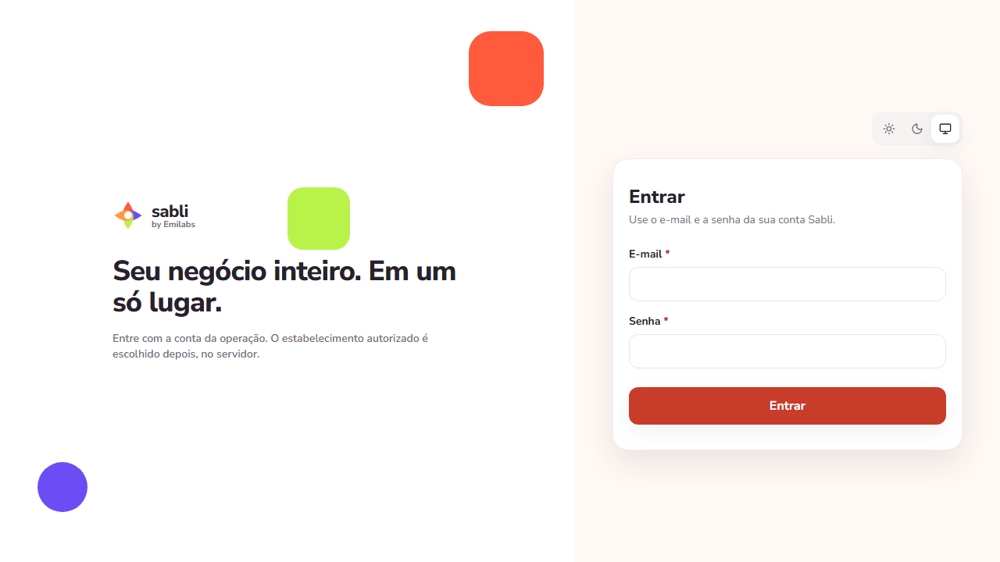
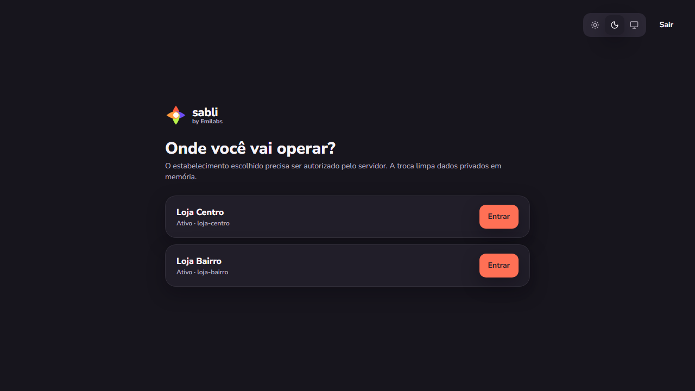

# Sabli by Emilabs

Plataforma full stack para o dia a dia de restaurantes e pizzarias. Slogan: **Seu negócio inteiro. Em um só lugar.**

O Sabli cobre salão, cardápio, PDV, cozinha, comandas e caixa em um monólito modular multi-tenant. Este repositório é um projeto de portfólio: roda localmente, sem hospedagem nem clientes em produção.

## Problema

Operar uma pizzaria pede o mesmo contexto em várias superfícies: mapa de mesas, pedido com pizza fracionada, fila da cozinha e quitação no caixa. Ferramentas isoladas quebram esse fluxo. O Sabli concentra a operação com precificação no servidor e isolamento por estabelecimento.

## O que já funciona

- Autenticação JWT + refresh em cookie HttpOnly
- Organizações, estabelecimentos e papéis
- Catálogo, variações e cotação de pizza
- PDV, pedidos persistidos e KDS
- Mesas, atendimentos e encerramento
- Comandas, pagamentos manuais e caixa

Dois modos independentes: **DEMO** (fixtures, sem API) e **API** (PostgreSQL real). Erro HTTP não cai no DEMO.

Ainda não há relatórios, gestão de equipe, adquirente, TEF, fiscal, estorno nem deploy.

## Stack

| Camada | Tecnologia |
| --- | --- |
| SPA | React 19, TypeScript, Vite, Tailwind 4 |
| API | Java 25, Spring Boot 4, Flyway |
| Banco | PostgreSQL 17 |
| Testes | Vitest, JUnit + Testcontainers, Playwright |
| CI | GitHub Actions |

## Arquitetura

```text
React SPA
   ↓
Cliente HTTP (access em memória)
   ↓
Spring Boot API (domínios modulares)
   ↓
PostgreSQL 17
```

Multi-tenancy é Organization → Establishment. O JWT não carrega loja: o servidor valida membership a cada operação. Dinheiro trafega em centavos. Pagamentos aceitam `Idempotency-Key`. Detalhes em [arquitetura](docs/arquitetura.md).

## Destaques técnicos

- Modos DEMO e API explícitos, sem fallback silencioso
- Precificação de pizza no servidor, item congelado no pedido
- Isolamento de tenant: recurso alheio responde 404
- Cookie de refresh `HttpOnly`, `SameSite=Lax`, path `/api/v1/auth`
- Cadastro inicial só com `BOOTSTRAP_TOKEN` (sem admin fixo no Git)
- CI com frontend, API, Playwright mockado e Playwright contra PostgreSQL

## Screenshots

| Login | Estabelecimento |
| --- | --- |
|  |  |

Mais imagens em `docs/screenshots/`.

## Como executar

Requisitos: Node.js 22+, npm 11+, JDK 25 LTS, Docker Desktop.

```powershell
git clone <url>
cd sabli
npm ci
copy .env.example .env
copy apps\api\.env.example apps\api\.env
```

Preencha `SABLI_DATASOURCE_PASSWORD`, `SABLI_JWT_SECRET` (≥ 32 caracteres), `SABLI_BOOTSTRAP_SIGNUP_TOKEN`, `SABLI_DEV_EMAIL` e `SABLI_DEV_PASSWORD` (≥ 10 caracteres). A senha do banco precisa coincidir com a do Compose.

```powershell
npm run db:up
npm run api:dev
npm run dev:seed
npm run dev:api
```

- DEMO, sem API: `npm run dev` → `http://127.0.0.1:5173/`
- API: frontend em `5173`, backend em `8080`
- Parar o PostgreSQL: `npm run db:down` (API e Vite param com `Ctrl+C`)

Guia completo: [desenvolvimento local](docs/desenvolvimento-local.md).

## Testes

| Comando | Suíte |
| --- | --- |
| `npm run typecheck` / `npm run lint` / `npm run build` | Qualidade do SPA |
| `npm test` | Vitest |
| `npm run api:test` | JUnit + Testcontainers |
| `npm run test:e2e` | Playwright mockado |
| `npm run test:e2e:real` | Playwright com API e PostgreSQL |

## Limitações

Projeto de portfólio, não um produto em produção. Sem cloud, homologação ou clientes reais. Relatórios e equipe ainda não ligados. PIX e cartão são declaração do operador.

## Documentação

- [Handbook](docs/projeto.md)
- [Desenvolvimento local](docs/desenvolvimento-local.md)
- [Arquitetura](docs/arquitetura.md)
- [Estado atual](docs/estado-atual.md)
- [Backend](docs/backend.md)
- [Consolidação Git](docs/git-consolidacao.md)
